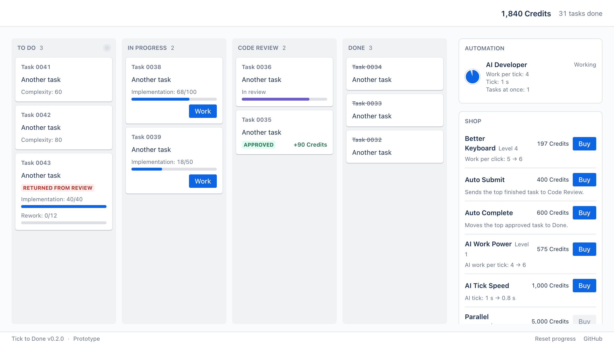

# Tick to Done

A small incremental / idle clicker about software development, played on a Kanban board.

Drag a task to In Progress, click **Work** until it is implemented, send it to Code Review, and move it to Done to get paid. Spend Credits on a better keyboard, an AI developer and automations that take tasks, submit them and close them for you — until the board runs itself.



## Play

**[Play in the browser →](https://vasylievivan.github.io/tick-to-done/)**

Desktop browser with a mouse or a touchpad. Progress is saved in your browser; **Reset progress** in the footer starts over.

This is an early prototype: one kind of task, English only, and the balance changes as it gets played.

## Run locally

Requires Node.js 24 and npm.

```bash
npm install
npm run dev        # development server at http://localhost:5173
npm run playtest   # production build, opened in the browser
```

Other scripts:

```bash
npm run check      # types, lint, unit tests and build
npm run verify     # check plus browser tests (Playwright, uses installed Google Chrome)
npm run sim        # balance simulation
```

Built with TypeScript, React and Vite. The game rules live in `src/core` as plain, deterministic TypeScript; the balance numbers are in `src/config/balance.ts`.

## License

No license is granted: the code is public to read and play, but all rights are reserved.
